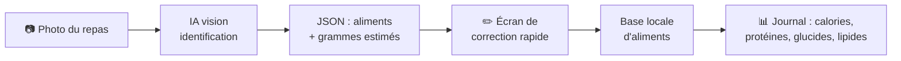

# Azimiam

**Azimiam** (jeu de mots « Azimut » + « Miam », WildZimut) est une application Flutter de comptage calorique par photo : on photographie son assiette, une IA de vision identifie les aliments et estime les quantités, l'utilisateur corrige en quelques secondes, et les valeurs nutritionnelles sont calculées **localement** à partir d'une base d'aliments embarquée.



## Principe de design

**L'IA identifie, elle ne calcule jamais.** Les modèles de vision qui donnent des calories directement hallucinent. Azimiam leur fait renvoyer uniquement un tableau JSON d'aliments + quantités ; les valeurs nutritionnelles viennent de la base locale (mini-base CIQUAL-esque aujourd'hui, import complet de CIQUAL dans la roadmap).

**La correction est le produit.** La recherche (précision de 68-86 % pour l'identification, mais jusqu'à 39 % pour les portions) montre que la valeur d'une app de ce type se joue sur la facilité de corriger les quantités : champ grammes éditable en direct sur chaque ligne, dialogue d'édition complet, ajout manuel avec autocomplétion, badge « hors base, à vérifier » sur les aliments non reconnus.

## Fonctionnalités (v0.1)

- 📷 Photo (caméra ou galerie) → analyse par modèle de vision (Mistral Pixtral par défaut, tout endpoint « chat completions » compatible OpenAI convient)
- ✏️ Correction rapide : quantité en direct, édition nom + valeurs / 100 g, suppression de ligne
- 🥗 Mini-base locale de ~110 aliments courants avec alias de recherche (accents, synonymes)
- ➕ Ajout manuel avec suggestions de la base, ou saisie libre à compléter
- 📊 Journal quotidien : total vs objectifs (calories, protéines, glucides, lipides), navigation entre les jours
- 💾 SQLite local, réglages persistés (clé API, modèle, objectifs)
- 🖼️ Photo du repas archivée dans l'app et affichée dans le journal

## Structure

```
lib/
  main.dart                    # point d'entrée, thème, locale fr
  models/
    valeurs.dart              # ValeursNutritionnelles (pour 100 g ou totaux)
    repas.dart                # LigneRepas, Repas, typesRepas
  data/
    mini_base.dart            # ~110 aliments, valeurs / 100 g (approx. CIQUAL)
  services/
    service_ia.dart           # appel vision + parseur JSON tolérant (testé)
    service_nutrition.dart    # normalisation, matching, suggestions (testé)
    service_base.dart         # SQLite : repas + lignes
    service_reglages.dart     # SharedPreferences : clé API, objectifs
  state/
    journal.dart              # ChangeNotifier : journée, totaux, erreurs
  screens/
    accueil_ecran.dart        # résumé + liste des repas + navigation jours
    ajout_repas_ecran.dart    # photo → IA → correction → enregistrement
    reglages_ecran.dart       # clé API, modèle, objectifs
test/
  service_ia_test.dart        # 10 tests : parsing tolérant
  service_nutrition_test.dart # 14 tests : normalisation, matching, calculs
  mini_base_test.dart         # intégrité de la mini-base
```

## Démarrage

Le dépôt contient uniquement `lib/`, `test/`, `pubspec` et la CI (même convention que l'Atelier Sprites) : la coque plateforme est générée par `flutter create`, sans rien écraser.

```bash
flutter create --org wildzimut --project-name azimiam --platforms android .
flutter pub get
flutter run
```

Clé API : Réglages → « Couche IA (vision) » → coller une clé [console.mistral.ai](https://console.mistral.ai) (modèle par défaut : `pixtral-12b-2409`). Sans clé, l'app fonctionne entièrement en saisie manuelle.

## CI/CD

`.github/workflows/build-apk.yml` : à chaque push sur `main` (et en PR) —
1. `flutter create` (coque Android à la volée) + `pub get`
2. `flutter analyze` (infos non bloquantes) puis **`flutter test` bloquant**
3. `flutter build apk --release` → artefact `azimiam-release-apk`

Le workflow a été validé sur un projet identique : analyse sans erreur, 24/24 tests, compilation complète OK.

## Roadmap

- 📦 **Import CIQUAL complet** (open data ANSES, ~2 750 aliments + micronutriments) en remplacement de la mini-base
- 🏷️ **Scan de code-barres** via Open Food Facts (produits industriels)
- 📈 Historique hebdomadaire / mensuel avec graphiques (`fl_chart`)
- ⭐ Favoris et repas récurrents (« recopier le déjeuner d'hier »)
- 🧠 Apprentissage des corrections de l'utilisateur (calibrer les quantités par aliment sur l'historique)
- 📴 Mode hors-ligne : modèle embarqué (TFLite / ML Kit) en repli sans réseau
- ⚖️ Poids/taille/objectifs avec calcul d'objectifs automatiques

## Avertissements

- Les valeurs de la mini-base sont **approximatives** (prototype) : l'import CIQUAL complet est prioritaire dans la roadmap.
- Azimiam est un outil d'information, pas un dispositif médical.
