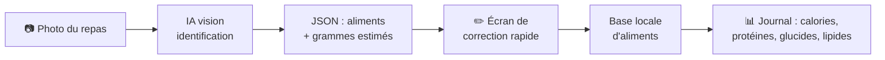

# Azimiam

**Azimiam** (jeu de mots « Azimut » + « Miam », WildZimut) est une application Flutter de comptage calorique par photo : on photographie son assiette, une IA de vision identifie les aliments et estime les quantités, l'utilisateur corrige en quelques secondes, et les valeurs nutritionnelles sont calculées **localement** à partir d'une base d'aliments embarquée.



## Principe de design

**L'IA identifie, elle ne calcule jamais.** Les modèles de vision qui donnent des calories directement hallucinent. Azimiam leur fait renvoyer uniquement un tableau JSON d'aliments + quantités ; les valeurs nutritionnelles viennent de la base locale (mini-base CIQUAL-esque aujourd'hui, import complet de CIQUAL dans la roadmap).

**La correction est le produit.** La recherche (précision de 68-86 % pour l'identification, mais jusqu'à 39 % pour les portions) montre que la valeur d'une app de ce type se joue sur la facilité de corriger les quantités : champ grammes éditable en direct sur chaque ligne, dialogue d'édition complet, ajout manuel avec autocomplétion, badge « hors base, à vérifier » sur les aliments non reconnus — et depuis la v0.6.1, création de l'aliment manquant **depuis la ligne elle-même** (fiche pré-remplie, valeurs réutilisées par les prochaines analyses IA).

## Fonctionnalités (v0.1)

- 📷 Photo (caméra ou galerie) → analyse par modèle de vision (Mistral Pixtral par défaut, tout endpoint « chat completions » compatible OpenAI convient) ; l'IA renvoie des noms courts (« Lasagne ») rapprochés de la base par mots avec bonus début de nom (v0.6.1 : fini les « Steak haché » pour une lasagne décrite en longueur)
- ✏️ Correction rapide : quantité en direct, édition nom + valeurs / 100 g, suppression de ligne
- 🥗 Mini-base locale de ~120 aliments courants avec alias de recherche (accents, synonymes), complétée par les aliments que vous ajoutez
- ➕ Ajout manuel **intégré à l'écran d'ajout** (champ + suggestions de la base + « Saisie libre »), sans boîte de dialogue bloquante
- 📊 Journal quotidien : total vs objectifs (calories, protéines, glucides, lipides), navigation entre les jours ; **un repas saisi depuis la page d'une journée est daté de cette journée** (v0.6.2 : fini le dîner d'hier enregistré « aujourd'hui »), la journée est visible et modifiable dans l'écran d'ajout, et **la date d'un repas se corrige depuis l'écran de modification** (l'heure enregistrée est conservée : les étiquettes Petit-déjeuner/Déjeuner/Collation/Dîner suffisent)
- 💾 SQLite local, réglages persistés (clé API, modèle, objectifs, profil)
- ⚖️ **Profil & IMC** : taille, âge, sexe, activité et objectif de poids (maintien / perte / prise avec poids cible) ; calcul automatique des objectifs caloriques (métabolisme de base Mifflin-St Jeor × facteur d'activité, ajusté à l'objectif avec planchers de sécurité 1 200 / 1 500 kcal) et du poids idéal (formule de Devine)
- 📈 **Suivi des progressions** : pesées historisées (une par jour, SQLite), courbe de poids, catégorie IMC (OMS), progression vers le poids cible (% parcouru, durée estimée à ~7 700 kcal/kg), moyennes d'apports 7/30 jours et graphique des calories des 14 derniers jours vs objectif (dessiné nativement, sans dépendance graphique)
- 📅 **Plan nutritionnel** : fixe les **objectifs globaux** de la journée (kcal, protéines, glucides, lipides) et affiche la progression réelle du jour (réalisé / objectif / reste) — **sans imposer de plats précis**
- 🏃 **Activités sportives** : déclaration d'une séance (type parmi 16, date et heure, durée, distance et dénivelé positif le cas échéant), **calories dépensées calculées automatiquement** (MET du type ajusté à la vitesse pour la course et le vélo, travail de montée ajouté au dénivelé, sur la base de la dernière pesée) ou saisies à la main ; historique groupé par jour, résumé des 7 derniers jours (séances, durée, km, kcal)
- ⭐ Favoris & repas récurrents (« recopier le déjeuner d'hier ») : étoile sur la carte du repas, section « Repas fréquents » sur l'accueil, recréation en un appui sur la journée affichée (table SQLite `favoris`) ; catalogue d'aliments avec recherche instantanée **multi-mots** insensible aux accents (« pommes terre » retrouve « Pommes de terre cuites ») et **aliments personnels persistants** (bouton « + » du catalogue : nom, alias, valeurs / 100 g, stockés dans SQLite `aliments_perso`, supprimables d'un swipe, immédiatement disponibles dans la recherche de l'écran d'ajout et le rapprochement IA)
- 📤 Export CSV du journal, des pesées et des activités sportives (dossier `Téléchargements/Azimiam`)
- ℹ️ Menu « À propos » : version embarquée telle que définie dans le `pubspec.yaml` (ex. `0.2.0-pr8+25` en PR, `0.2.0+25` sur main), principe de l'app et avertissement
- 🎨 Icône d'app dédiée (assiette + couverts sur fond vert) : PNG mipmap 48→192 px + icône adaptative vectorielle (Android 8+)
- 🖼️ Photo du repas archivée dans l'app et affichée dans le journal

## Structure

```
lib/
  main.dart                    # point d'entrée, thème, locale fr, providers
  version.dart                 # version embarquée (regénérée par la CI au build)
  models/
    valeurs.dart              # ValeursNutritionnelles (pour 100 g ou totaux)
    repas.dart                # LigneRepas, Repas, typesRepas
    profil.dart               # Profil : taille, âge, sexe, activité, objectif
    progression.dart          # Pesee, TotalJour
    favori.dart               # FavoriRepas : snapshot JSON + empreinte
    activite.dart            # ActiviteSport : type, durée, distance, dénivelé, kcal
  data/
    mini_base.dart            # ~120 aliments, valeurs / 100 g (approx. CIQUAL)
  services/
    service_ia.dart           # appel vision + parseur JSON tolérant (testé)
    service_nutrition.dart    # normalisation, matching, suggestions (testé)
    service_imc.dart          # IMC (OMS), Mifflin-St Jeor, objectifs auto (testé)
    service_base.dart         # SQLite : repas, lignes, pesées, totaux/jour
    service_reglages.dart     # SharedPreferences : clé API, objectifs, profil
    service_export.dart       # export CSV du journal + pesées + activités (testé)
    service_activites.dart    # catalogue de types + calcul kcal MET/vitesse/dénivelé (testé)
  state/
    journal.dart              # ChangeNotifier : journée, totaux, erreurs
    progression.dart          # ChangeNotifier : pesées, totaux 30 j, réglages
    activites.dart            # ChangeNotifier : séances sportives, totaux 7 j
    catalogue.dart            # ChangeNotifier : base + aliments perso (doublons, ajout, suppression)
  screens/
    accueil_ecran.dart        # résumé + liste des repas + navigation jours + menu
    ajout_repas_ecran.dart    # photo → IA → correction → enregistrement + ajout manuel inline
    modifier_repas_ecran.dart # modification d'un repas : type, lignes, total
    catalogue_ecran.dart      # catalogue complet : recherche multi-mots, ajout d'aliments perso
    progression_ecran.dart    # IMC, courbe de poids, apports 7/14/30 jours
    plan_ecran.dart           # objectifs globaux du jour vs réalisé (sans plats imposés)
    activites_ecran.dart      # déclaration des activités sportives + historique
    a_propos_ecran.dart       # écran « À propos » (version embarquée)
    reglages_ecran.dart       # clé API, modèle, profil, objectifs (+ calcul auto)
test/
  service_ia_test.dart        # 10 tests : parsing tolérant
  service_nutrition_test.dart # 14 tests : normalisation, matching, calculs
  service_imc_test.dart       # IMC, métabolisme, objectifs auto, durées
  favori_test.dart            # sérialisation favoris + empreintes
  service_export_test.dart    # export CSV
  version_test.dart           # format de la version embarquée
  mini_base_test.dart         # intégrité de la mini-base
  widget_accueil_test.dart    # tests widget : bouton menu (tiroir ☰ + popup ⋮) et navigation
  widget_ajout_test.dart      # tests widget : ajout manuel inline (suggestion base / saisie libre)
  service_activites_test.dart # calculs kcal : MET, vitesse, dénivelé, catalogue
  widget_activites_test.dart  # tests widget : écran Activités + dialogue de déclaration
  widget_catalogue_test.dart  # tests widget : catalogue (compteur base+perso, multi-mots, fiche d'ajout)
  widget_dialog_nouvel_aliment_test.dart  # tests widget : fiche de création (succès, doublon, pré-remplissage)
  repas_test.dart             # helpers de date (dateSeule, instantPour jour affiché)
  widget_modifier_repas_test.dart  # tests widget : date éditable du repas
android/                       # coque Android versionnée (signature release configurée)
.github/workflows/build-apk.yml  # CI : tests, APK signé, Release GitHub
```

## Démarrage

Le dossier `android/` est versionné (coque générée une fois par `flutter create`, puis adaptée : config de signature release dans `android/app/build.gradle`). Les binaires (wrapper Gradle, icônes) sont stockés en Base64 (`.b64`) et décodés automatiquement par la CI ; pour un build local, décodez-les d'abord :

```bash
find android -name '*.b64' | while read f; do base64 -d "$f" > "${f%.b64}"; rm "$f"; done
flutter pub get
flutter run
```

Clé API : Réglages → « Couche IA (vision) » → coller une clé [console.mistral.ai](https://console.mistral.ai) (modèle par défaut : `pixtral-12b-2409`). Sans clé, l'app fonctionne entièrement en saisie manuelle.

## CI/CD

`.github/workflows/build-apk.yml` : à chaque push sur `main` (et en PR), ou manuellement (onglet Actions → Run workflow) —
1. Décodage des binaires `.b64`, `pub get`
2. `flutter analyze` (infos non bloquantes) puis **`flutter test` bloquant**
3. `flutter build apk --release`, **signé** si les secrets sont configurés (repli sur clé debug sinon) ; `versionCode` = n° de build (`GITHUB_RUN_NUMBER`) porté par le `pubspec.yaml`. **En pull request**, le n° de PR est ajouté à la `versionName` de l'APK (`0.2.0` → `0.2.0-pr3`, soit `version: 0.2.0-pr3+<build>` dans le pubspec) et au **nom du fichier** : **`azimiam-v<version>-pr<N>-<n° de build>.apk`**, téléchargeable via l'artefact `azimiam-release-apk` du run. Sur `main`, chaque **merge de PR** publie aussi l'APK dans la Release, nommé avec le n° de la PR fusionnée (`azimiam-v<version>-<build>-pr<N>.apk`, lu dans le commit de merge) et mentionné dans les notes de release. La même version est écrite dans `lib/version.dart` au build (affichée dans « À propos »).
4. **Publication d'une Release GitHub** `v<version>` (lue dans `pubspec.yaml`, **hors PR uniquement**) avec l'APK **`azimiam-v<version>-<n° de build>.apk`** attaché ; si le tag existe déjà, l'APK est re-téléversé (`--clobber`) ; à chaque publication, les anciens assets `azimiam-*.apk` de la Release sont **supprimés automatiquement**, il ne reste que **l'APK du dernier build** (évite d'installer un build périmé)

Le workflow a été validé sur un projet identique : analyse sans erreur, 24/24 tests, compilation complète OK.

## Signature de l'APK

L'APK release est signé via un keystore **jamais commité dans le dépôt** (`key.properties`, `*.p12`, `*.jks`, `*.keystore` sont ignorés). `android/app/build.gradle` lit `android/key.properties` s'il existe :

```properties
storeFile=azimiam-release.p12
storePassword=<mot de passe du keystore>
keyAlias=azimiam
keyPassword=<mot de passe de la clé>
```

En CI, la signature s'active dès que ces secrets GitHub sont définis (Settings → Secrets and variables → Actions) :

| Secret | Contenu |
| --- | --- |
| `ANDROID_KEYSTORE_BASE64` | keystore `.p12` encodé Base64 (`base64 -w0 azimiam-release.p12`) |
| `ANDROID_KEYSTORE_PASSWORD` | mot de passe du keystore et de la clé |
| `ANDROID_KEYSTORE_ALIAS` | alias de la clé (`azimiam`) |

Sans ces secrets, le build reste signé avec la clé debug (installable en test, mais non publiable sur le Play Store).

## Roadmap (priorisée, avec approche)

**P0 — prochaine PR**

- ⭐ **Favoris & repas récurrents** (« recopier le déjeuner d'hier ») : table SQLite v3 `favoris` (snapshot JSON des lignes : nom, grammes, valeurs / 100 g), étoile sur la carte du repas, section « Repas fréquents » sur l'accueil ; un appui recrée le repas à la date du jour. ✅ fait en v0.3 (étoile + « Repas fréquents »).

**P1**

- 📈 **Historique hebdo / mensuel** : les graphiques natifs existants (barres 14 j, courbe de poids) passent à 7 / 30 / 90 j avec moyennes glissantes ; les totaux sont déjà agrégés côté SQL (`totauxParJour`). Aucune dépendance ajoutée. ✅ fait en v0.3 (7/14/30/90 j + moyennes 7/30/90).
- 🏷️ **Scan de code-barres** via Open Food Facts : `mobile_scanner` + appel API OFF (code → produit), pré-remplissage de la ligne avec badge « Open Food Facts », repli saisie manuelle hors réseau (permission réseau déjà présente via le package http).

**P2**

- 🧠 **Apprentissage des corrections** : journaliser (aliment, quantité proposée par l'IA, quantité corrigée) et proposer la médiane par aliment à la prochaine photo. L'IA identifie toujours, elle ne calcule jamais.
- 📦 **Import CIQUAL complet** (open data ANSES, ~2 750 aliments + micronutriments) : script de conversion CSV → asset embarqué, en remplacement de la mini-base ; les tests de cohérence kcal/macros seront étendus à toute la base.
- 📤 **Export CSV** du journal et des pesées (partage ou suivi externe). ✅ fait en v0.3 (CSV dans `Téléchargements/Azimiam`).

**P3**

- 📴 **Mode hors-ligne** : modèle embarqué (TFLite / ML Kit) en repli sans réseau — chantier à cadrer séparément.
- ⚖️ Poids/taille/objectifs avec calcul d'objectifs automatiques ✅ (fait : profil + IMC + objectifs auto)

## Avertissements


- Les valeurs de la mini-base sont **approximatives** (prototype) : l'import CIQUAL complet est prioritaire dans la roadmap.
- Azimiam est un outil d'information, pas un dispositif médical.

