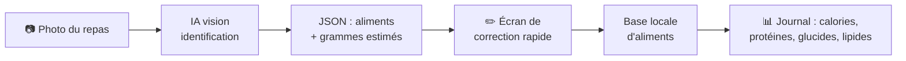

# Azimiam

**Azimiam** (jeu de mots « Azimut » + « Miam », WildZimut) est une application Flutter de comptage calorique par photo : on photographie son assiette, une IA de vision identifie les aliments et estime les quantités, l'utilisateur corrige en quelques secondes, et les valeurs nutritionnelles sont calculées **localement** à partir d'une base d'aliments embarquée.



## Principe de design

**L'IA identifie, elle ne calcule jamais.** Les modèles de vision qui donnent des calories directement hallucinent. Azimiam leur fait renvoyer uniquement un tableau JSON d'aliments + quantités ; les valeurs nutritionnelles viennent de la base locale (mini-base CIQUAL-esque aujourd'hui, import complet de CIQUAL dans la roadmap).

**La correction est le produit.** La recherche (précision de 68-86 % pour l'identification, mais jusqu'à 39 % pour les portions) montre que la valeur d'une app de ce type se joue sur la facilité de corriger les quantités : champ grammes éditable en direct sur chaque ligne, dialogue d'édition complet, ajout manuel avec autocomplétion, badge « hors base, à vérifier » sur les aliments non reconnus.

## Fonctionnalités (v0.1)

- 📷 Photo (caméra ou galerie) → analyse par modèle de vision (Mistral Pixtral par défaut, tout endpoint « chat completions » compatible OpenAI convient)
- ✏️ Correction rapide : quantité en direct, édition nom + valeurs / 100 g, suppression de ligne
- 🥗 Mini-base locale de ~110 aliments courants avec alias de recherche (accents, synonymes)
- ➕ Ajout manuel avec suggestions de la base, ou saisie libre à compléter
- 📊 Journal quotidien : total vs objectifs (calories, protéines, glucides, lipides), navigation entre les jours
- 💾 SQLite local, réglages persistés (clé API, modèle, objectifs, profil)
- ⚖️ **Profil & IMC** : taille, âge, sexe, activité et objectif de poids (maintien / perte / prise avec poids cible) ; calcul automatique des objectifs caloriques (métabolisme de base Mifflin-St Jeor × facteur d'activité, ajusté à l'objectif avec planchers de sécurité 1 200 / 1 500 kcal) et du poids idéal (formule de Devine)
- 📈 **Suivi des progressions** : pesées historisées (une par jour, SQLite), courbe de poids, catégorie IMC (OMS), progression vers le poids cible (% parcouru, durée estimée à ~7 700 kcal/kg), moyennes d'apports 7/30 jours et graphique des calories des 14 derniers jours vs objectif (dessiné nativement, sans dépendance graphique)
- 📅 **Plan nutritionnel** : journée type générée depuis la mini-base locale et mise à l'échelle des objectifs (répartition 25/35/10/30 %, variantes qui tournent jour par jour), consultable à n'importe quelle date et ajoutable au journal en un geste
- 🖼️ Photo du repas archivée dans l'app et affichée dans le journal

## Structure

```
lib/
  main.dart                    # point d'entrée, thème, locale fr, providers
  models/
    valeurs.dart              # ValeursNutritionnelles (pour 100 g ou totaux)
    repas.dart                # LigneRepas, Repas, typesRepas
    profil.dart               # Profil : taille, âge, sexe, activité, objectif
    progression.dart          # Pesee, TotalJour
  data/
    mini_base.dart            # ~110 aliments, valeurs / 100 g (approx. CIQUAL)
  services/
    service_ia.dart           # appel vision + parseur JSON tolérant (testé)
    service_nutrition.dart    # normalisation, matching, suggestions (testé)
    service_imc.dart          # IMC (OMS), Mifflin-St Jeor, objectifs auto (testé)
    service_plan.dart         # plan nutritionnel du jour (testé)
    service_base.dart         # SQLite : repas, lignes, pesées, totaux/jour
    service_reglages.dart     # SharedPreferences : clé API, objectifs, profil
  state/
    journal.dart              # ChangeNotifier : journée, totaux, erreurs
    progression.dart          # ChangeNotifier : pesées, totaux 30 j, réglages
  screens/
    accueil_ecran.dart        # résumé + liste des repas + navigation jours + menu
    ajout_repas_ecran.dart    # photo → IA → correction → enregistrement
    progression_ecran.dart    # IMC, courbe de poids, apports 7/14/30 jours
    plan_ecran.dart           # plan nutritionnel du jour, ajoutable au journal
    reglages_ecran.dart       # clé API, modèle, profil, objectifs (+ calcul auto)
test/
  service_ia_test.dart        # 10 tests : parsing tolérant
  service_nutrition_test.dart # 14 tests : normalisation, matching, calculs
  service_imc_test.dart       # IMC, métabolisme, objectifs auto, durées
  service_plan_test.dart      # gabarits, rotation, ajustement aux objectifs
  mini_base_test.dart         # intégrité de la mini-base
android/                       # coque Android versionnée (signature release configurée)
.github/workflows/build-apk.yml  # CI : tests, APK signé, Release GitHub
```

## Démarrage

Le dossier `android/` est versionné (coque générée une fois par `flutter create`, puis adaptée : config de signature release dans `android/app/build.gradle`). Les binaires (wrapper Gradle, icônes) sont stockés en Base64 (`.b64`) et décodés automatiquement par la CI ; pour un build local, décodez-les d'abord :

```bash
find android -name '*.b64' | while read f; do base64 -d "$f" > "${f%.b64}"; rm "$f"; done
flutter pub get
flutter run
```

Clé API : Réglages → « Couche IA (vision) » → coller une clé [console.mistral.ai](https://console.mistral.ai) (modèle par défaut : `pixtral-12b-2409`). Sans clé, l'app fonctionne entièrement en saisie manuelle.

## CI/CD

`.github/workflows/build-apk.yml` : à chaque push sur `main` (et en PR), ou manuellement (onglet Actions → Run workflow) —
1. Décodage des binaires `.b64`, `pub get`
2. `flutter analyze` (infos non bloquantes) puis **`flutter test` bloquant**
3. `flutter build apk --release`, **signé** si les secrets sont configurés (repli sur clé debug sinon) ; `versionCode` = n° de build (`GITHUB_RUN_NUMBER`) porté par le `pubspec.yaml`. **En pull request**, le n° de PR est ajouté à la `versionName` de l'APK (`0.2.0` → `0.2.0-pr3`, soit `version: 0.2.0-pr3+<build>` dans le pubspec) et au **nom du fichier** : **`azimiam-v<version>-pr<N>-<n° de build>.apk`**, téléchargeable via l'artefact `azimiam-release-apk` du run.
4. **Publication d'une Release GitHub** `v<version>` (lue dans `pubspec.yaml`, **hors PR uniquement**) avec l'APK **`azimiam-v<version>-<n° de build>.apk`** attaché ; si le tag existe déjà, l'APK est re-téléversé (`--clobber`)

Le workflow a été validé sur un projet identique : analyse sans erreur, 24/24 tests, compilation complète OK.

## Signature de l'APK

L'APK release est signé via un keystore **jamais commité dans le dépôt** (`key.properties`, `*.p12`, `*.jks`, `*.keystore` sont ignorés). `android/app/build.gradle` lit `android/key.properties` s'il existe :

```properties
storeFile=azimiam-release.p12
storePassword=<mot de passe du keystore>
keyAlias=azimiam
keyPassword=<mot de passe de la clé>
```

En CI, la signature s'active dès que ces secrets GitHub sont définis (Settings → Secrets and variables → Actions) :

| Secret | Contenu |
| --- | --- |
| `ANDROID_KEYSTORE_BASE64` | keystore `.p12` encodé Base64 (`base64 -w0 azimiam-release.p12`) |
| `ANDROID_KEYSTORE_PASSWORD` | mot de passe du keystore et de la clé |
| `ANDROID_KEYSTORE_ALIAS` | alias de la clé (`azimiam`) |

Sans ces secrets, le build reste signé avec la clé debug (installable en test, mais non publiable sur le Play Store).

## Roadmap

- 📦 **Import CIQUAL complet** (open data ANSES, ~2 750 aliments + micronutriments) en remplacement de la mini-base
- 🏷️ **Scan de code-barres** via Open Food Facts (produits industriels)
- 📈 Historique hebdomadaire / mensuel plus poussé (graphique 14 jours et courbe de poids déjà dessinés nativement)
- ⭐ Favoris et repas récurrents (« recopier le déjeuner d'hier »)
- 🧠 Apprentissage des corrections de l'utilisateur (calibrer les quantités par aliment sur l'historique)
- 📴 Mode hors-ligne : modèle embarqué (TFLite / ML Kit) en repli sans réseau
- ⚖️ Poids/taille/objectifs avec calcul d'objectifs automatiques ✅ (fait : profil + IMC + objectifs auto)

## Avertissements

- Les valeurs de la mini-base sont **approximatives** (prototype) : l'import CIQUAL complet est prioritaire dans la roadmap.
- Azimiam est un outil d'information, pas un dispositif médical.

